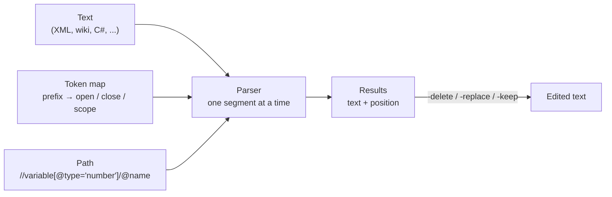

# objParser

**Query any structured text with a path, without parsing it into a tree first.**

objParser pulls data out of XML, HTML, wiki pages, VB.NET, C# or any format you can describe with
delimiters. You describe the format once in a small **token map** ("an element starts with `<name`
and ends with `</name>`"), then ask for what you want with an XPath-like path:

```console
$ objParser -f model.xml -x "//variable[@type='number']/@name"
alpha
gamma
```

There is no DOM and no grammar. Each path segment picks a pair of delimiters from the map, and
the parser searches for them inside the results of the previous segment. That makes it fast,
tolerant of broken input, and easy to point at a new format: it's a text file, not code.



## Contents

- [Quick start](#quick-start)
- [Built-in maps by example](#built-in-maps-by-example)
- [Writing your own map file](#writing-your-own-map-file)
- [Using the library](#using-the-library)
- [Documentation](#documentation)
- [Project layout](#project-layout)

## Quick start

You need the [.NET 9 SDK](https://dotnet.microsoft.com/download).

```console
dotnet build ObjectParser.sln
dotnet test ObjectParser.sln

# run the CLI
dotnet run --project src/objParser -- -f examples/model.xml -x "//variable/@name"
```

### A free-standing objParser.exe

A ready-to-run Windows build is checked in at
[`dist/win-x64/objParser.exe`](dist/win-x64/objParser.exe) (about 11 MB). It's one file with the
.NET runtime built in, so you can copy it anywhere and run it without installing anything.

The checked-in exe is a snapshot that gets refreshed now and then, not on every change.
`objParser -ver` shows the commit it was built from. To build a current one yourself:

```console
dotnet publish src/objParser -p:PublishProfile=win-x64
```

This overwrites `dist/win-x64/objParser.exe`. Commit it only when you mean to refresh the snapshot.

During development the build output is `src/objParser/bin/Debug/net9.0/objParser.exe`, which
needs the .NET 9 runtime. Run either one with no arguments for a usage summary. Input comes from
`-f <file>` or from stdin:

```console
$ type examples\model.xml | objParser //variable/@name
```

## Built-in maps by example

Pick a map with `-xml` (default), `-xml_ext`, `-html`, `-vb` or `-cs`. Print any map with
`objParser -showmap -<name>`. All the examples below use files in this repository, and their output is
copied from real runs.

### XML

[`examples/model.xml`](examples/model.xml) is a small configuration model.

| You want | Path | Result |
|---|---|---|
| an attribute | `//variable/@name` | `alpha` `beta` `gamma` |
| elements matching a filter | `//variable[@type='number']/@name` | `alpha` `gamma` |
| elements *without* something | `//variable[!flags]/@name` | `gamma` |
| an element's text | `//variable/-node` | `first` |
| the direct children of an element | `//projatt/` | the three `<att …>` elements |
| attribute names | `//variable/$` (with `-s`) | `attr` `name` `type` `value` |
| element names | `//variable/#` | `flags` `flag` `node` `flags` `flag` |

Filters can compare against other parts of the document. A **sub-path** in `{{…}}` is evaluated
first, and a **multi-path** `{:a,b:}` asks for several element names at once:

```console
$ objParser -f examples/model.xml -x "//{:variable,decision,objective:}[flags/flag/@attr='{{//index[flags/flag/@attr~'portfolio']/@name}}']/@name"
beta
d1
```

That reads as: *find the index flagged "portfolio…", then list every variable, decision or
objective whose flag points at that index.*

Edit instead of query with `-delete`. Each match is cut out exactly where it was found. Add
`-replace <text>` or `-keep <path>` to put something in its place:

```console
$ objParser -f examples/model.xml -x "//index" -x "//projatt" -delete
```

### HTML (wiki pages)

`-html` uses the XML map. These run against
[`wiki.html`](tests/ObjectParser.Tests/TestData/wiki.html), a process page:

```console
$ objParser -html -f wiki.html -x "//table/tr/-td"
Build
Pat
QA
Sam

$ objParser -html -f wiki.html -x "//a/@href"
/wiki/Tests
/wiki/Rollback
/wiki/Hotfix

$ objParser -html -f wiki.html -x "//li[@class~'done']/!"
Tag the build
```

### VB.NET

```console
$ objParser -vb -f Sample.vb -x "//Invoice/p" -x "//Invoice/$"
Total
AddLine
Reset
```

`//Invoice` gives the whole class, `//Invoice/!Total` one function, `//Invoice/;` parameter names
and `//#` the types used. See [built-in maps](docs/built-in-maps.md#vb) for every prefix.

### C#

C# blocks end at a *matching* brace, so the C# map uses balanced tokens (`%{}`):

```console
$ objParser -cs -f Sample.cs -x "//Invoice/m"
Invoice
Add
Total
Dispose

$ objParser -cs -f Sample.cs -x "//Invoice/!Add/("
decimal amount, int qty
qty > 0
amount * qty
```

Also available: `//n` namespaces, `//u` usings, `//c` and `//b` comments, `//#` regions,
`//iIShape` interfaces, `//eColor` enums. Calls like `Add(x);` are not mistaken for declarations.

## Writing your own map file

A map is a text file. Each **prefix** gets three lines: the open token, the close token, and the
**scope** to return: `I` (inside), `O` (outside, delimiters included) or `F` (the name the `*`
matched). Lines starting with `##` are comments.

Here is part of [`examples/mediawiki.map`](examples/mediawiki.map), which reads MediaWiki markup:

```text
## h2       == Heading == text                  //h2
h2=\n==\s
h2=\s==
h2=I

## target   the page each link points to        //target
##          close token "|\||]]": the nearest of "|" (escaped) or "]]"
target=[[
target=|\||]]
target=I

## li       * bullet item text                  //li
##          "\*" is a literal star; a bare * would be the field placeholder
li=\n\*\s
li=|\n|\r
li=I

## Name     a section's body, by heading: after "== Name ==" up to the next
##          level-2 heading or the end of the page   //Steps   //Owners/li
 =\n==\s*\s==
 =|\n==\s|\n==\s
 =I
```

Use it with `-m`:

```console
$ objParser -m examples/mediawiki.map -f examples/release.wiki -x "//h2"
Steps
Owners

$ objParser -m examples/mediawiki.map -f examples/release.wiki -x "//Owners/li"
Build: Pat
QA: Sam

$ objParser -m examples/mediawiki.map -f examples/release.wiki -x "//target" -count
Rollback
Hotfix
Tests
On-call
Results returned: 4
```

The last entry has a space as its prefix, which makes it the **default**: a path segment with no
prefix (`//Owners`) uses it, and `*` is replaced by the segment's name.

What the token characters mean:

| In a token | Meaning | Example |
|---|---|---|
| `*` | the path segment's name; if the segment has none, it is read from the text | `<*` matches `<variable` for `//variable` |
| `a^b` | find `a`, then jump forward to `b` | `<*^>`: tag name, then its `>` |
| `a?b\|c` | close token: if the open match ended in `a`, use `b`, else `c` | `/>?/>\|</*^>` for self-closing tags |
| `a\|b\|c` | find `a`, then the nearest of `b` or `c` | `\|\r\|\n`: up to the end of the line |
| `%{}` | balanced: through the brace that closes the next `{` (`%{};` gives up at a `;`) | C# class and method bodies |
| `\n \r \t \s` | newline, return, tab, space | `\n==\s` |
| `\* \^ \| \? \%` | the character itself | `/\*` for a C# comment |

A close token that starts with `|` or `^` is a *lookahead*: it marks where a match ends but leaves
the text for the next match, and the end of the text also counts. That's how `li` above finds
every bullet even though each bullet ends where the next one begins.

The full reference is in [docs/token-maps.md](docs/token-maps.md).

## Using the library

```vb
Imports ObjectParser

Dim parser = New Parser(TokenMap.BuiltIn("xml"), File.ReadAllText("model.xml"))
Dim names = parser.Query("//variable/@name")          ' {"alpha", "beta", "gamma"}

For Each m In parser.QueryMatches("//variable/@type")  ' each result knows where it came from
    Console.WriteLine($"{m.Start}: {m.Value}")
Next

Dim wiki = New Parser(TokenMap.FromFile("mediawiki.map"), File.ReadAllText("release.wiki"))
Dim owners = wiki.Query("//Owners/li")

parser.Delete("//index")                               ' edits parser.Text in place
```

## Documentation

| Page | What's in it |
|---|---|
| [Command line](docs/cli.md) | every option, exit codes, examples |
| [Path syntax](docs/path-syntax.md) | segments, prefixes, filters, sub-paths, multi-paths |
| [Token maps](docs/token-maps.md) | writing map files: tokens, scopes, escapes, a worked example |
| [Built-in maps](docs/built-in-maps.md) | every prefix of the xml, xml_ext, vb and cs maps |
| [How it works](docs/architecture.md) | the engine, with diagrams |
| [Changes since v4.1](docs/changes.md) | what the 2026 modernization fixed and added |

## Project layout

```text
src/ObjectParser/        the library: Parser, TokenMap, PathExpression, built-in maps
src/objParser/           the command-line tool
tests/ObjectParser.Tests xUnit tests, including a 300-document cross-check against System.Xml
examples/                model.xml, mediawiki.map, release.wiki (used by the tests too)
docs/                    reference documentation
```

objParser was written in 2010 (v4.1, Visual Studio 2008) to mine process wiki pages and VB code.
The original sources are kept under the git tag `v4.1-legacy`.
