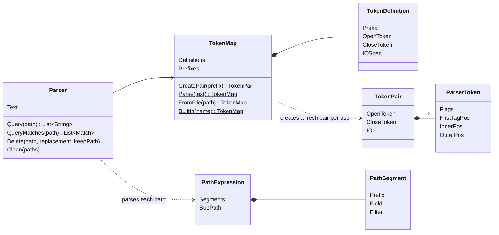
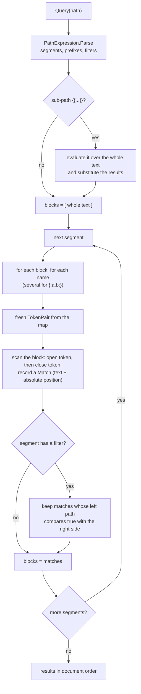
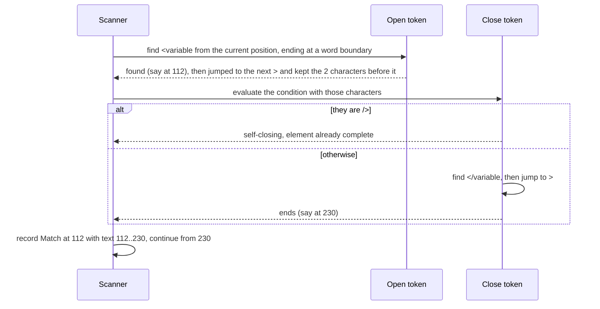

# How it works

objParser never builds a tree. A query is a series of plain string searches, steered by the token
map. This page follows one query through the engine.

## The pieces



| Class | Job |
|---|---|
| `TokenMap` | holds the map's entries; hands out a **new** `TokenPair` every time one is needed, so nested searches never share state |
| `ParserToken` | parses one token string (`<*^>`, `/>?/>\|</*^>`, `%{};`, …) and remembers where it last matched |
| `PathExpression` | splits a path into segments, keeping `/` inside `[...]` intact; pulls out the `{{sub-path}}` |
| `Parser` | runs the segments, applies filters, records each result's position, and does deletes |
| `ParserSyntax` | the special characters (`.`, `*`, `^`, `?`, `\|`, `{{`, `[`, …), all changeable |

## Evaluating a path



Each segment searches **inside the results of the previous one**, which is why
`//variable/@name` finds only the names inside variables. After the first segment, the search
starts just past the parent's own opening tag, so the parent isn't found again.

## One scan, step by step

For `//variable` with the XML map, the default entry is:

```text
 =<*^>            open:  "<" + name, then jump to ">"
 =/>?/>|</*^>     close: self-closing? done : "</" + name, then jump to ">"
 =O|O             return the whole element
```



The scan repeats until the open token isn't found. If a close token fails for one candidate, the
scan moves on to the next open match.

## Filters run nested parsers

`//variable[@type='number']` evaluates `@type` with a separate `Parser` over each variable's
text, then compares. A right-hand path like `//controls/type/@value` runs its own parser over the
whole document. Because every parser gets fresh token pairs from the map, these nested runs can't
disturb the outer scan. That was a real source of wrong results in v4.1, where a single pair was
shared.

## Positions and editing

Every result is a `Match` with its absolute start offset in `Parser.Text`. That is what makes
`Delete` exact: matches are sorted, nested ones are dropped, and the text is rebuilt around the
spans. The cross-check tests generate random XML documents, record where each element was written,
and confirm that every reported position is right.

## Why no tree?

- **Any format**: a new format is a few lines of map text, not a grammar or a parser.
- **Broken input is fine**: an unclosed tag just means fewer matches. Random-input tests run every
  built-in map against garbage and check it never hangs or throws.
- **Fast enough**: 20,000 elements are queried in well under a second in the tests.

The cost: nesting is only understood where the map describes it (balanced braces, or a distinct
close token). Elements nested inside an element of the same name aren't supported.
